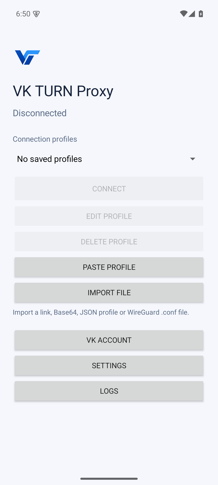

# VK TURN Proxy for Android

[Русский](README.ru.md)

A native Android VPN client with a Kotlin interface and a Go WireGuard/TURN backend shared with VK TURN Proxy Desktop.



## Requirements

- Android 8.0 or newer.
- A compatible WireGuard server and an HTTPS VK call invitation link.
- A `vkturnproxy://import?data=…` connection link, Base64 payload, version 1 JSON profile/backup, or a full-tunnel WireGuard `.conf` file.

## Use

Download the signed APK from GitHub Releases. When switching from a debug APK, uninstall the debug application and import your profiles again. [Releases](https://github.com/artemk1337/vk-turn-proxy-android/releases)

1. Install the APK and open VK TURN Proxy.
2. Paste a desktop connection link, Base64 or JSON, or import a profile file. For a WireGuard configuration, enter the VK call invitation link and import the `.conf` file. Opening a `vkturnproxy` link from another application also opens the import screen.
3. Select the profile, tap Connect and approve Android's VPN permission request.
4. Disconnect in the application or its persistent notification.

Profiles are stored in private application storage with backups disabled. The foreground VPN service keeps the connection independent of the activity. The application routes its own transport traffic over the underlying network and captures IPv6 to prevent it from bypassing the IPv4 tunnel.

Edit a saved profile to change its name, peer, VK invitation link, SRTP/DTLS mode, TURN TCP/UDP selection, connection count, MTU, DNS and keepalive. Defaults and limits come from the shared desktop settings contract. Profile edits preserve WireGuard keys and unknown imported metadata. The selected profile is restored on startup.

Use Edit source to replace an existing profile's JSON, connection link or WireGuard configuration while retaining its saved ID.

Application settings control English/Russian language, light/dark theme, boot startup, the log limit and automatic routing catalog updates. Boot startup requires an existing Android VPN permission and a selected profile.

## VK account

Open the account screen to sign in through an isolated VK website window or import cookies in Netscape/header format. The application retains only the cookies needed by the shared transport and encrypts the saved account using Android Keystore. Account health is checked every five minutes while the application process runs. Logout clears the saved account. Changes apply to the next connection.

When VK requests a captcha, keep the connection running and open the captcha screen to complete the challenge. Captcha URLs and answers remain outside application logs and presentation preferences.

## Routing

Each profile can send all IPv4 traffic through the VPN, include selected destinations, or exclude selected destinations. Choose GeoIP/GeoSite tags or enter domain suffixes, IPv4 addresses and subnets. Local destinations can use the physical network. Download the routing catalogs from settings before selecting catalog rules.

Routing uses a per-connection snapshot. The Android VPN captures traffic, then a userspace network stack opens direct or WireGuard connections according to the policy. DNS responses are classified before reaching applications, including CNAME answers and HTTPS/SVCB IPv4 hints. Configured DNS stays reachable through the tunnel and IPv6 remains blocked. Failed catalog updates retain the previous complete catalog pair. Changes apply on the next connection.

Selective routing forwards TCP, UDP and ICMP. Other IPv4 protocols require the full-tunnel mode with local-direct disabled.

Android 15 emulator checks cover desktop deep-link import, parameter editing, source replacement with a stable profile ID, metadata/key preservation, selected-profile persistence, language and theme settings. Backend tests exercise direct/tunnel TCP and UDP forwarding, DNS policy enforcement and ICMP. Live VK authentication and VPN traffic with a working server profile require device verification.

## Build

Install Go 1.26, JDK 21 and the Android command-line tools. Set `ANDROID_HOME` to your SDK directory and `JAVA_HOME` to your JDK. Install the SDK packages and build the backend before running Gradle.

```sh
sdkmanager 'platforms;android-35' 'build-tools;35.0.0' 'ndk;27.2.12479018'
scripts/build-backend.sh
./gradlew testDebugUnitTest lintDebug assembleDebug
```

The generated APK is `app/build/outputs/apk/debug/app-debug.apk`. The backend AAR includes ARM64, ARMv7 and x86_64. The debug APK uses Android's development signing key. Production distribution requires your own release signing configuration.

Published APKs use the project's release signing key, stored separately from this repository. Build an unsigned release with `./gradlew assembleRelease`, then sign it with Android SDK `apksigner` and the same key to preserve update compatibility.

```sh
cd backend
go test -race ./...
go vet ./...
```

GitHub Actions builds the debug APK and uploads it as a workflow artifact.

## Related projects

- Shared transport and desktop application. [VK TURN Proxy Desktop](https://github.com/artemk1337/vk-turn-proxy-desktop)
- Original shared transport by anton48, cacggghp and other upstream contributors. [vk-turn-proxy-ios](https://github.com/anton48/vk-turn-proxy-ios)
- Related server implementation. [vk-turn-proxy](https://github.com/anton48/vk-turn-proxy)

GPL-3.0. See [LICENSE](LICENSE) and [NOTICE.md](NOTICE.md).
