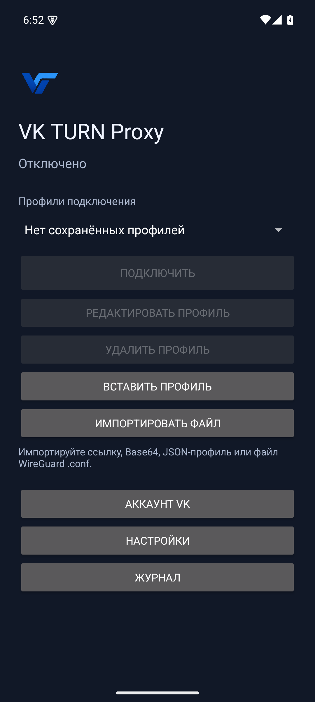

# VK TURN Proxy для Android

[English](README.md)

Нативный VPN-клиент для Android с интерфейсом на Kotlin и общим с десктопным приложением транспортом WireGuard/TURN на Go.



## Требования

- Android 8.0 или новее.
- Совместимый WireGuard-сервер и HTTPS-ссылка для присоединения к звонку VK.
- Ссылка подключения `vkturnproxy://import?data=…`, строка Base64, JSON-профиль/резервная копия версии 1 или полнотуннельная конфигурация WireGuard `.conf`.

## Использование

Скачайте подписанный APK из GitHub Releases. При переходе с отладочного APK удалите debug-приложение и повторно импортируйте профили. [Релизы](https://github.com/artemk1337/vk-turn-proxy-android/releases)

1. Установите APK и откройте VK TURN Proxy.
2. Вставьте ссылку подключения из десктопного клиента, Base64 или JSON либо импортируйте файл профиля. Для конфигурации WireGuard сначала введите ссылку на звонок VK, затем импортируйте `.conf`. Открытие ссылки `vkturnproxy` из другого приложения также вызывает экран импорта.
3. Выберите профиль, нажмите «Подключить» и подтвердите системный запрос на создание VPN.
4. Отключайте VPN из приложения или постоянного уведомления.

Профили хранятся во внутреннем каталоге приложения. Резервное копирование отключено. Подключение работает в foreground-сервисе независимо от окна приложения. Собственный транспорт приложения использует физическое подключение. IPv6 перехватывается, чтобы исключить обход IPv4-туннеля.

В редакторе профиля доступны имя, адрес сервера, ссылка на звонок VK, SRTP/DTLS, TCP/UDP для TURN, число соединений, MTU, DNS и keepalive. Значения по умолчанию и ограничения берутся из общего с десктопом контракта настроек. Редактирование сохраняет ключи WireGuard и неизвестные поля исходного профиля. Выбранный профиль восстанавливается при запуске.

Через «Изменить исходник» можно заменить JSON, ссылку подключения или конфигурацию WireGuard существующего профиля с сохранением его ID.

В настройках приложения доступны язык, светлая/тёмная тема, автозапуск при загрузке устройства, лимит лога и автоматическое обновление каталогов маршрутизации. Для автозапуска нужны ранее выданное разрешение Android на VPN и выбранный профиль.

## Аккаунт VK

Откройте экран аккаунта для входа через изолированное окно сайта VK или импорта cookies в формате Netscape/HTTP-заголовка. Приложение сохраняет необходимые транспорту cookies в зашифрованном виде с использованием Android Keystore. Проверка сессии выполняется каждые пять минут, пока работает процесс приложения. Выход удаляет сохранённый аккаунт. Изменения применяются при следующем подключении.

Если VK запросит капчу, оставьте подключение активным и откройте экран капчи. URL и ответы капчи остаются за пределами логов и настроек интерфейса.

## Маршрутизация

Для каждого профиля можно направить весь IPv4-трафик в VPN, включить выбранные назначения или исключить их. Доступны GeoIP/GeoSite, суффиксы доменов, IPv4-адреса и подсети. Локальные назначения могут использовать физическую сеть. Перед выбором правил из каталогов скачайте базы через настройки приложения.

Подключение использует снимок правил профиля. Android VPN перехватывает трафик, а пользовательский сетевой стек открывает прямые соединения или соединения через WireGuard согласно политике. DNS-ответы классифицируются до передачи приложениям, включая CNAME и IPv4-подсказки HTTPS/SVCB. Настроенный DNS доступен через туннель, IPv6 заблокирован. При ошибке обновления сохраняется предыдущая полная пара каталогов. Изменения применяются при следующем подключении.

Выборочная маршрутизация пересылает TCP, UDP и ICMP. Для остальных IPv4-протоколов используйте полный туннель с отключённым прямым доступом к локальной сети.

На эмуляторе Android 15 проверены импорт десктопной ссылки, редактирование параметров, замена исходного профиля с сохранением ID, сохранность метаданных и ключей, восстановление выбранного профиля, язык и тема. Тесты бэкенда проверяют прямую и туннельную пересылку TCP/UDP, DNS-политики и ICMP. Вход в реальный аккаунт VK и VPN-трафик с рабочим серверным профилем требуют проверки на устройстве.

## Сборка

Установите Go 1.26, JDK 21 и Android command-line tools. Укажите путь к SDK в `ANDROID_HOME`, а путь к JDK в `JAVA_HOME`. Сначала соберите Go-бэкенд, затем приложение.

```sh
sdkmanager 'platforms;android-35' 'build-tools;35.0.0' 'ndk;27.2.12479018'
scripts/build-backend.sh
./gradlew testDebugUnitTest lintDebug assembleDebug
```

APK появится в `app/build/outputs/apk/debug/app-debug.apk`. AAR включает ARM64, ARMv7 и x86_64. Отладочный APK подписывается ключом разработки Android. Для распространения релизной версии настройте собственную подпись.

Опубликованные APK подписаны релизным ключом проекта, который хранится отдельно от репозитория. Команда `./gradlew assembleRelease` собирает неподписанный релизный APK. Для совместимости обновлений подписывайте его через Android SDK `apksigner` тем же ключом.

```sh
cd backend
go test -race ./...
go vet ./...
```

GitHub Actions собирает отладочный APK и сохраняет его в артефактах запуска.

## Связанные проекты

- Общий транспорт и десктопное приложение. [VK TURN Proxy Desktop](https://github.com/artemk1337/vk-turn-proxy-desktop)
- Исходный транспорт от anton48, cacggghp и других участников. [vk-turn-proxy-ios](https://github.com/anton48/vk-turn-proxy-ios)
- Серверная реализация. [vk-turn-proxy](https://github.com/anton48/vk-turn-proxy)

GPL-3.0. См. [LICENSE](LICENSE) и [NOTICE.md](NOTICE.md).
